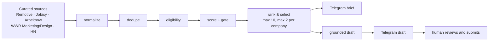

# Job Finder Bot

A job-search pipeline that turns role-relevant public job feeds into a short, ranked shortlist of
**creative strategist, copywriter, email/lifecycle marketing, and content strategist** roles — and
prepares a posting-grounded application draft for each one.

Built as a personal tool. The interesting work is not the fetching; it is deciding what *not* to show,
and writing outreach that cannot invent a fact.

> **Draft-only.** The bot never submits applications or sends email. You review each match, fill
> in your relevant experience, and submit it yourself.

---

## The problem

Two failure modes make job-search automation useless:

1. **Noise.** Aggregators return hundreds of listings; most are the wrong role, the wrong
   timezone, or country-locked. A daily digest that is 80% irrelevant trains you to ignore it.
2. **Fabrication.** Application drafts can make claims about experience the candidate has not
   provided. A single invented result can undermine an application.

This pipeline is built around both constraints: **default-deny role and location gates**, and
**deterministic, evidence-bound drafts** with explicit placeholders for candidate details that
have not yet been configured.

## Architecture



Every source passes through one normalizer: stable id, canonical URL, plain-text description capped
at 10k so role evidence later in longer postings remains available, and a remote flag the scorer can
trust. Dedupe collapses the same posting reached through two feeds using a canonical URL plus a
fuzzy company/title match.

## What it produces

One Telegram brief per run, followed by one packet per selected role:

```text
📝 Application Draft

Role:    Copywriter
Company: Example Co
To:      hiring@example.com          (or: Not found – apply via Job Link)
Source:  Remotive
Subject: Application: Copywriter at Example Co

Hello Example Co hiring team,

I'm applying for the Copywriter role. Your posting highlights:
"Write copy for landing pages and email campaigns."

Relevant experience: [Add a truthful example of relevant work and its result.]

Work sample: [Add a relevant portfolio or work-sample link.]

Regards,
<your name>

🔗 Job Link
https://jobs.example.com/ai-automation-engineer

— Copy & send/apply manually —
```

Packets are produced for **every** selected role, not just the ones with a contact address. When the posting lists no email, the packet says so and links the application page instead of
silently skipping it.

## Design decisions

**Default-deny geography.** A location passes only when it is an open region, is empty, or contains
nothing but remote words. Any leftover place name — "Kansas", "Seoul", "Americas" — means the role is
not worldwide. Country restictions are also read out of the title, because postings often encode them
there ("Backend Developer — Remote from EU").

**Evidence-gated role matching.** The title must identify one of the configured target role families,
including close content and lifecycle-marketing neighbors.
The description must also contain evidence from at least two distinct responsibility groups for that
family. Generic software, AI research, and marketing roles do not pass because they share a broad
keyword. Freshness and other ranking bonuses are applied only after both role and location gates pass.

**Deterministic drafting.** The application draft quotes a relevant sentence from the posting and
leaves candidate experience and portfolio details as placeholders unless the user configures them.
There is no model call and no invented work history.

**Human submission.** Drafts are delivered, not sent. Email sending and ATS submission are disabled.

**Ranking, not just filtering.** Only jobs that pass role evidence and geography gates are scored.
The brief displays the matched role family and evidence. At most two roles per company are selected.

## Stack

TypeScript · Node.js · VoltAgent workflow runtime · Zod · Telegram Bot API · GitHub Actions / Windows Task Scheduler

No database. State is two JSON files on disk (`data/seen-jobs.json`, `data/applications.json`),
which keeps the whole thing runnable on a free CI runner.

## Quickstart

```bash
npm install
cp .env.example .env      # add TELEGRAM_BOT_TOKEN and TELEGRAM_CHAT_ID
npm run build
npm test
npm run dev               # one run: fetch -> filter -> notify
```

### Configuration

| Variable | Purpose |
| --- | --- |
| `JOB_SOURCE` | `stub` for offline fixtures, `registry` for configured sources, or a single source name |
| `JOB_SOURCES` | Comma-separated source list; empty uses curated defaults (`remotive,jobicy,arbeitnow,wwr,hn`); `JOB_SOURCE=all` opts into all sources |
| `ASHBY_ORGS` | Optional Ashby org slugs; Ashby is excluded from the default because it lacks full job descriptions |
| `TELEGRAM_BOT_TOKEN` / `TELEGRAM_CHAT_ID` | Alert destination; leave blank to log only |
| `SENDER_NAME` | Name used in the application-draft signature |

Candidate experience and portfolio details live in `profile/outreach.json`. Copy
`profile/outreach.example.json` and fill them in; the file is gitignored so personal details remain local.

The default feeds are configured for role coverage: Remotive's public RSS feed; Jobicy's `marketing`
and `creative` tags; Arbeitnow's broad recent-job feed; We Work Remotely's sales/marketing and design
RSS categories; and Hacker News' latest "Who is hiring?" thread. Remote OK and Ashby remain available
as opt-in sources, but are omitted from normal runs because current feeds are broad or lack the job
description detail needed to validate a role.

### Scheduling

- **GitHub Actions** — `.github/workflows/daily-jobs.yml`, cron `0 6 * * *` (07:00 WAT)
- **Windows** — `run-daily.ps1` via Task Scheduler, logs to `logs/`

## Tests

```bash
npm test
```

Tests cover normalization, geography, each target role's title and description evidence gates,
rejection of unrelated roles, draft grounding, company caps, fuzzy dedupe, and HN reply filtering.

## Limits

- Sources are free-tier public APIs, so a board can change shape without warning. Each adapter is
  isolated, and a source failure degrades the run rather than killing it.
- Strict matching favors precision over volume and may miss relevant jobs whose titles or descriptions
  use unusual wording. False-positive rates still need to be measured against reviewed live results.
- Drafts require the candidate to fill in their relevant experience and portfolio details before submission.
- The JSON store is per-machine. A scheduled CI run and a local run do not share state.
- Email discovery is best-effort: many postings simply do not list a contact address.

## Contact

[Email](mailto:ubaniekan29@gmail.com) · [X](https://x.com/Psarmhye) · [GitHub](https://github.com/Sammysystems)
