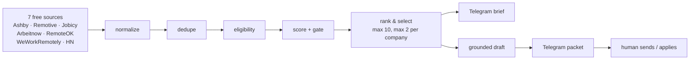

# Job Finder Bot

A job-search pipeline that turns seven free job feeds into a short, ranked shortlist of remote
**AI automation / agent / LLM integration** roles — and drafts a grounded cold email for each one,
ready to copy and send.

Built as a personal tool. The interesting work is not the fetching; it is deciding what *not* to show,
and writing outreach that cannot invent a fact.

> **No auto-apply, ever.** There is no ATS submission path (Greenhouse, Lever, Workday, Ashby,
> Workable). Every packet is sent to Telegram for a human to read and send.

---

## The problem

Two failure modes make job-search automation useless:

1. **Noise.** Aggregators return hundreds of listings; most are the wrong role, the wrong
   timezone, or country-locked. A daily digest that is 80% irrelevant trains you to ignore it.
2. **Fabrication.** "AI outreach" tools generate confident emails containing claims the model made up.
   A single invented metric ends the conversation.

This pipeline is built around both constraints: **default-deny filtering**, and **deterministic,
evidence-bound drafting** — no LLM in the email path at all.

## Architecture



Every source passes through one normalizer: stable id, canonical URL, plain-text description capped
at 2k, and a remote flag the scorer can trust. Dedupe collapses the same posting reached through two
feeds using a canonical URL plus a fuzzy company/title match.

## What it produces

One Telegram brief per run, followed by one packet per selected role:

```text
📧 Email Draft

Role:    AI Automation Engineer
Company: Example Co
To:      hiring@example.com          (or: Not found – apply via Job Link)
Source:  Ashby
Subject: AI Automation Engineer at Example Co

Hi,

<problem-first paragraph, written from the job description>

<why this specific work matters to them>

<one concrete first step + a short CTA>

— <your sender name>
https://github.com/your-handle

🔗 Job Link
https://jobs.example.com/ai-automation-engineer

— Copy & send/apply manually —
```

Packets are produced for **every** selected role, not just the ones with a contact address. When the
posting lists no email, the packet says so and links the application page instead of silently skipping it.

## Design decisions

**Default-deny geography.** A location passes only when it is an open region, is empty, or contains
nothing but remote words. Any leftover place name — "Kansas", "Seoul", "Americas" — means the role is
not worldwide. Country restictions are also read out of the title, because postings often encode them
there ("Backend Developer — Remote from EU").

**Two-tier role matching.** A title that names AI/automation work passes on its own. A generic
engineering title passes only when the description proves AI/automation work. Everything else is
rejected, no matter how fresh it is.

**Deterministic drafting.** The email is assembled from the job description and a portfolio repo the
candidate actually owns. There is no model call, so there is nothing to hallucinate. This was a
deliberate trade: a slightly less fluent email that is always true beats a fluent one that is sometimes not.

**Human approval.** Drafts are delivered, not sent. The bot never emails on its own.

**Ranking, not just filtering.** Roles are scored on role match, description signals, freshness,
seniority, eligibility tier, and salary presence. At most two roles per company, so one employer
cannot fill the brief with near-identical postings.

## Stack

TypeScript · Node.js · VoltAgent workflow runtime · Zod · Telegram Bot API · Nodemailer (optional send path) · GitHub Actions / Windows Task Scheduler

No database. State is two JSON files on disk (`data/seen-jobs.json`, `data/applications.json`),
which keeps the whole thing runnable on a free CI runner.

## Quickstart

```bash
npm install
cp .env.example .env      # add TELEGRAM_BOT_TOKEN and TELEGRAM_CHAT_ID
npm run build
npm test
npm run dev               # one run: fetch -> filter -> notify
```

Optional, only if you want the bot to send mail itself (off by default):

```env
GMAIL_USER=you@gmail.com
GMAIL_APP_PASSWORD=your-app-password
```

### Configuration

| Variable | Purpose |
| --- | --- |
| `JOB_SOURCE` | `stub` for offline fixtures, otherwise a specific source id |
| `JOB_SOURCES` | Comma-separated source list; empty enables all |
| `ASHBY_ORGS` | Comma-separated Ashby org slugs to poll |
| `TELEGRAM_BOT_TOKEN` / `TELEGRAM_CHAT_ID` | Alert destination; leave blank to log only |
| `SENDER_NAME` | Name used in the email signature |
| `SENDER_GITHUB` | Portfolio link appended to each draft |
| `GMAIL_USER` / `GMAIL_APP_PASSWORD` | Optional direct-send path |

Sender profile and repo preferences live in `profile/outreach.json`. Copy
`profile/outreach.example.json` to start — that file is gitignored because it can hold credentials.

### Scheduling

- **GitHub Actions** — `.github/workflows/daily-jobs.yml`, cron `0 6 * * *` (07:00 WAT)
- **Windows** — `run-daily.ps1` via Task Scheduler, logs to `logs/`

## Tests

```bash
npm test
```

29 tests cover the parts that are easy to get quietly wrong: entity decoding and HTML stripping,
URL canonicalization, salary formatting, remote detection, geography classification, scoring gates,
company caps, fuzzy dedupe, and HN reply filtering.

## Limits

- Sources are free-tier public APIs, so a board can change shape without warning. Each adapter is
  isolated, and a source failure degrades the run rather than killing it.
- Drafting is template-based. It is grounded and honest, but it will not write like a human who
  researched the company for an hour.
- The JSON store is per-machine. A scheduled CI run and a local run do not share state.
- Email discovery is best-effort: many postings simply do not list a contact address.

## Contact

[Email](mailto:ubaniekan29@gmail.com) · [X](https://x.com/Psarmhye) · [GitHub](https://github.com/Sammysystems)
